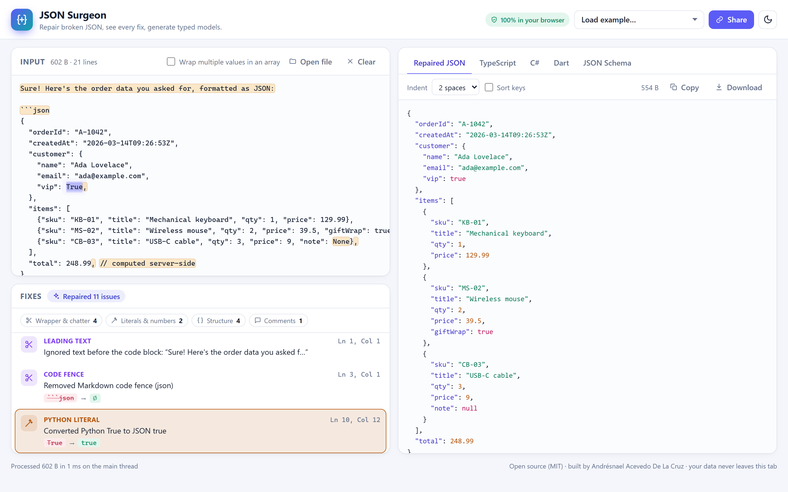

# JSON Surgeon

**Paste broken JSON and get valid JSON back, with an explanation for every fix and typed models for TypeScript, C#, Dart and JSON Schema. It all runs in your browser.**

**Live demo:** https://&lt;github-username&gt;.github.io/json-surgeon/



## Features

- **Repairs broken JSON and explains each fix.** Every repair comes with a plain-English message, its kind, and its line and column in *your* input, e.g. `Ln 10, Col 12 · Converted Python True to JSON true`.
- **Handles LLM output.** It strips Markdown code fences and the chatter before and after them ("Sure! Here's the JSON…"). When there are several JSON blobs it keeps the first and tells you so.
- **Handles truncated responses.** It closes unterminated strings, arrays and objects at the end of the input and reports what it appended.
- **Handles the usual mistakes:**
  - trailing, missing and doubled commas
  - `//`, `/* */` and `#` comments
  - single quotes, backticks and “smart quotes”
  - unquoted keys and values
  - Python `True` / `False` / `None` and tuples
  - JavaScript `undefined`, `NaN` and `Infinity` (each becomes `null`, with a note on why)
  - leading `+`, leading zeros, `.5`, hex/octal/binary numbers and digit separators
  - raw newlines and tabs inside strings, invalid escapes and unescaped inner quotes
  - mismatched brackets
  - Mongo-style `ObjectId("…")` wrappers and JSONP callbacks
- **Shows each fix on your input.** Every fix is highlighted in the editor. Click a fix and the editor scrolls to it and selects it. You can filter the list by category.
- **Formats the output.** 2 spaces, 4 spaces, tabs or minified, with optional recursive key sorting. Big integers keep their exact digits.
- **Generates typed models:**
  - **TypeScript** interfaces
  - **C# records** for `System.Text.Json`, with `[JsonPropertyName]`, `required`, nullable reference types, `List<T>`, `DateTimeOffset`/`Guid` detection and a configurable namespace
  - **Dart** null-safe classes with `fromJson`/`toJson`
  - **JSON Schema** draft 2020-12 with `$defs`

  Types are inferred by merging every element of an array. A field missing from some elements becomes *optional*, a field that is sometimes `null` becomes *nullable*, and conflicting types widen to the most general one. Class names come from the keys (`shipping_address` → `ShippingAddress`), and array items get singular names (`companies` → `Company`). You can copy or download any output.
- **Handles large files.** Inputs over 500 KB are parsed in a **Web Worker** with a progress bar, so the UI stays responsive. You can drag and drop a file or open one.
- **Supports JSON Lines.** An optional toggle wraps concatenated values in an array.
- **Keeps your data private.** Nothing is uploaded. The **Share** link carries your input in the URL hash, compressed with `CompressionStream('deflate-raw')` and encoded as base64url. Your last input is remembered in `localStorage`.
- **Light and dark themes.** They follow your OS setting, and a toggle overrides it. The layout works down to phone width.
- **CLI.** `json-surgeon fix broken.json` uses the same engine from Node.

## Why I built this

I work across C#/.NET, Angular and Flutter. Two small jobs kept coming up: JSON that *almost* parses, and typing the matching model in three languages. "Almost" covers an LLM answer wrapped in Markdown, an API response cut off mid-string, or a Python dict pasted from a log.

Most repair tools fix the JSON silently. I wanted one that shows **what it changed and why**, because a silent fix can hide a real bug, like a truncated payload. I also wanted it to go one step further and produce the models I would otherwise write by hand.

This project was also a chance to build something real with modern Angular: standalone components, signals, the new control flow, OnPush and zoneless change detection, with the hard logic kept in plain, well-tested TypeScript.

## How the repair engine works

The engine (`src/core/repair/repair.ts`) is a **hand-written recursive-descent parser** that tolerates mistakes. It does not rewrite the text with regular expressions. It parses the *original* text, so every repair is recorded with an exact offset in your input.

1. **Unwrap.** If the input doesn't start like JSON, it looks for a Markdown code fence. Otherwise it skips leading prose up to the first `{` or `[`.
2. **Parse with recovery.** The parser reads like a strict one, but at each point where strict parsing would throw, it applies a local recovery and logs it:
   - a missing comma before another key is inserted
   - a `]` inside an object closes the object, if an array is open further out
   - a `"` followed by more text on the same line is treated as an unescaped quote inside the string
   - a word that isn't a literal becomes a quoted string
3. **Finish.** At the end of the input it closes everything still open (`"`, `}`, `]`) and reports it as truncation. Anything left after the value is reported as trailing text or as extra values.
4. **Emit.** It returns a small syntax tree. Numbers keep their source text, so `12345678901234567890` is never rounded. The tree is then formatted, or fed to type inference.

The parser never throws on bad input. Its output is always strict JSON, and a fuzz test checks that.

Type inference (`src/core/model`) builds a *shape* for each value and merges shapes across array elements. It then turns the merged shape into named classes, giving one class to structurally identical objects. The generators in `src/core/generators` render the classes. All of this is framework-free, so the web app, the Web Worker and the CLI share it.

## Tech stack

- **Angular 20**: standalone components, signals, `@if`/`@for`, OnPush, zoneless change detection
- **TypeScript** (strict) for a framework-free core in `src/core`
- **Vitest**: 168 tests covering the repair engine, inference, generators, the share codec, the highlighter and the CLI
- **Web Workers** for large inputs, and the **Compression Streams API** for share links
- Hand-written **SCSS** with CSS custom properties. No UI library, icon font or web font.
- **esbuild** to bundle the CLI
- **GitHub Actions** for CI, and **GitHub Pages** for deployment

## Run locally

Requires Node.js 20 or newer.

```bash
npm install
npm start            # http://localhost:4200
```

## Run tests

```bash
npm test             # Vitest, headless (node environment)
npm run test:coverage
npm run typecheck    # strict tsc over core, CLI and app
npm run build        # production build → dist/json-surgeon/browser
```

## CLI

```bash
npm run build:cli
node cli/dist/json-surgeon.mjs fix broken.json            # repaired JSON on stdout, fixes on stderr
node cli/dist/json-surgeon.mjs explain llm-answer.txt     # list every fix
node cli/dist/json-surgeon.mjs types data.json --lang cs --root Order --namespace Acme.Api
cat lines.jsonl | node cli/dist/json-surgeon.mjs fix - --jsonl --indent minify
node cli/dist/json-surgeon.mjs fix config.json --check -q # exit code 1 if repairs were needed
```

## Project structure

```
src/
  core/                    framework-free TypeScript (tested with Vitest)
    repair/                tolerant parser, repair kinds and messages
    json/                  syntax tree and formatter
    model/                 shape inference, naming rules, class model
    generators/            TypeScript, C#, Dart, JSON Schema
    highlight/             tiny HTML syntax highlighter and repair marks
    share/                 deflate-raw + base64url codec for share links
    examples.ts            bundled example inputs
  app/
    engine/                analysis service, Web Worker, shared pipeline
    components/            input editor, fix list, output panel, icons
    services/              theme, safe localStorage, toasts
cli/                       Node CLI (bundled with esbuild)
docs/screenshot.png
.github/workflows/         ci.yml, deploy.yml
```

## Deploy to GitHub Pages

`.github/workflows/deploy.yml` builds with `--base-href /json-surgeon/` and publishes through `actions/deploy-pages` on every push to `main`. To turn it on, open **Settings → Pages** in the repository and set **Source** to **GitHub Actions**.

## Roadmap

- [ ] Line-number gutter and a virtualized editor for multi-MB inputs
- [ ] More repair heuristics: unclosed strings in the middle of a document, string concatenation (`"a" + "b"`)
- [ ] More targets: Kotlin data classes, Go structs, Zod schemas, Pydantic models
- [ ] Enum detection for low-cardinality string fields
- [ ] Publish the core and CLI to npm
- [ ] PWA / offline install

## License

[MIT](LICENSE) © 2026 Andrésnael Acevedo De La Cruz
